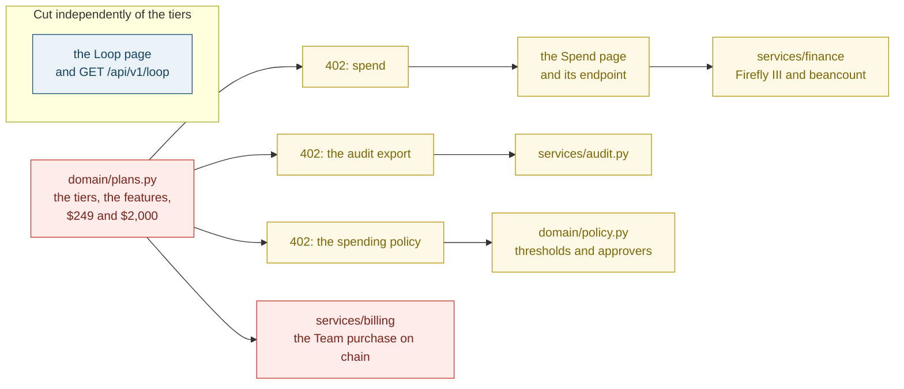
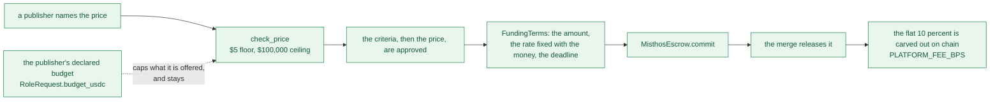
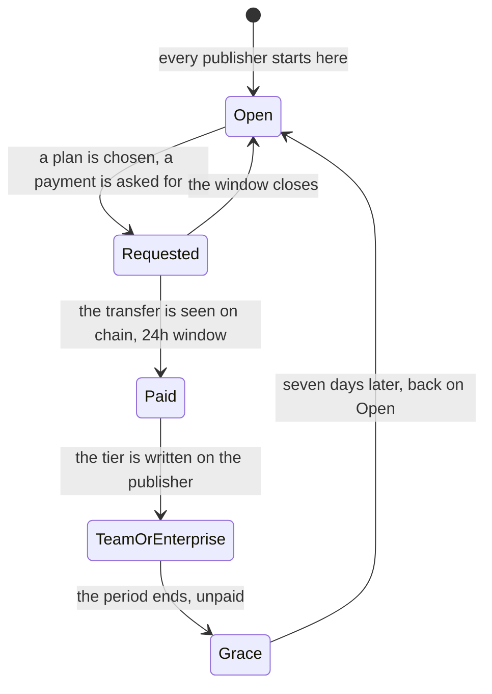
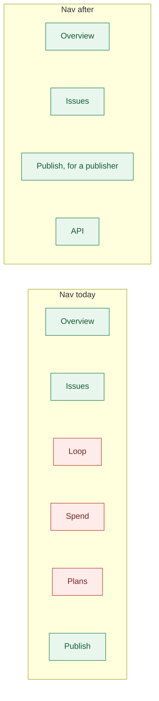
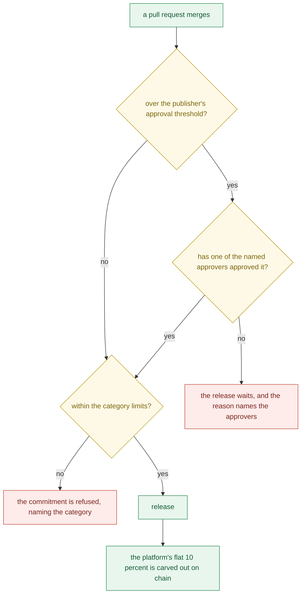

# Bounty: cut Loop, Spend and Plans, and the subscription pricing with them

Suggested labels: `enhancement`, `p1`, `area:backend`, `area:frontend`

## Deliverable

One pull request, merged, that removes three features whole — the **Loop**, **Spend** and
**Plans** pages, the routes behind them, the machinery they are the only way into, the
**subscription pricing model** they exist to sell, and the documentation that describes
it. What is left is one price discipline: a publisher names the price, the platform takes
a flat 10 percent on settlement, and nothing is gated by a plan. Nothing else changes.

This is a cut, not a refactor. The subscription model is being removed rather than
adjusted, and designing its replacement is a later issue; the product should not claim a
pricing model it does not have in the meantime.

## Context

Three pages are the whole of the subscription story, and each one is a doorway into much
more code than the page suggests.

| Page | What is actually behind it |
| --- | --- |
| **Plans** (`frontend/src/routes/Plans.tsx`) | `domain/plans.py` (124 lines: the five feature flags, the tier table, `Plan.take_rate`, `Plan.minimum_fix`, the refusal text), `api/v1/plans.py`, `services/billing/` and the Team purchase that pays 249 USDC on chain from `MISTHOS_PLATFORM_WALLET`, the `Subscription` records, and the sweeper's expiry pass |
| **Spend** (`frontend/src/routes/Spend.tsx`) | `GET /publishers/{id}/spend` and `GET /publishers/{id}/finance`, the Firefly III and beancount adapters (`services/finance/`, 409 lines), `MISTHOS_FINANCE_CONNECTIONS`, and the spending policy — approval thresholds, named approvers and category limits — that is not reporting but enforcement |
| **Loop** (`frontend/src/routes/Loop.tsx`) | `GET /api/v1/loop` (`api/v1/issues.py:570`), `LoopOut` and `LoopSettlement`, `Store.loop`, and the public-dashboard tests |

The three are not independent. Plans is the only thing that sells the other two:
`require_plan` answers 402 with "… is in the {plan} plan. See /plans to upgrade"
(`domain/plans.py:124`) in front of the spend route (`api/v1/publishers.py:80`), the audit
export (`:100`) and the policy route (`:55`). Remove the tiers and there is no way to buy
the features those refusals advertise, so the refusals and the features have to go
together or the app keeps a locked door with no key.

Two things in that table are easy to mistake for reporting and are not: the **spending
policy** is enforced where money moves — `store.py:1066-1150` refuses a release over the
approval threshold without one of the named approvers, and refuses a commitment that
breaches a category limit — and the **audit export** is the record an auditor is given
(#52). Removing them changes behaviour and takes an artefact away, which is why both are
called out as the publisher's decision below rather than swept up silently.

### What must not go with it

The subscription model is not the pricing the money path is built on. Those are separate,
and the second half is not touched:

The engine's advice, the calibration corpus and the tier table are three different things,
and only the last one is this issue's business: the tier table is the **subscription**
model, and `Plan.take_rate` and `Plan.minimum_fix` only restate what
`PLATFORM_FEE_BPS` and `MINIMUM_PRICE` already say (`domain/pricing.py:31`, `:34`, `:56`).

### The machinery behind one page

This is why a page costs more than a page to remove. The subscription lifecycle lives in
the store and the sweeper:

Every state in that diagram is code: `store.entitled` (`store.py:1799`), the subscription
view (`:1824-1839`), the payment window (`:1878`, `:1937`), `sweep_subscriptions`
(`:2060-2090`) and the sweeper's own pass (`workers/sweeper.py:174`), the `Subscription`
table and the publisher's `tier` column (`migrations/versions/0009_subscriptions.py`),
and `services/billing/arc.py`, which is the only thing that pays the platform on chain
outside the escrow.

### The app after the cut

## The model

After this, the platform has one revenue line and one price discipline: the flat 10
percent of a settled issue, carved out by the escrow, and a publisher's own price between
$5 and $100,000. There is no tier, no subscription, no 402, and no feature that waits on
a plan. What the publisher's declared budget does — cap what it is offered — stays, and
`Plan.take_rate` is gone because there is no longer a second place to say what the rate is.

Two consequences worth stating plainly, because they are what the cut is for:

- **Nothing is gated.** A publisher on Open reaches everything a publisher could reach on
  Enterprise. The only refusals left are the money's own: the two price bounds, the
  criteria, and whatever the publisher's own policy says if the policy stays.
- **The pages' addresses are gone, not hidden.** `/loop`, `/spend` and `/plans` are not
  routed, no link points at them, and the API's own schema no longer offers their
  endpoints. A bookmark lands on the app's not-found page.

## What is yours to decide

Three calls belong to the publisher, and the pull request should mark them plainly. The
first one is the only removal that changes what the money does, so it is worth seeing:

- **The release approval gate** (drawn above; `domain/policy.py`, enforced at
  `store.py:1066-1150`). Approval thresholds, named approvers and category limits are a
  control rather than a report: with the plan gone, deleting them means a release over a
  threshold no longer waits for a person. Keeping them means keeping a control that was
  sold as a Team feature and is now free. Either is defensible; what is not is deleting
  the gate by accident because the page that advertised it went.
- **The audit export** (`services/audit.py`, `#52`). It is the decision record and the
  money events, unedited, for an auditor. It was gated by the Enterprise tier, but an
  auditor's artefact is not a tier feature, and a compliance story that outlives the
  subscription may want it kept and left ungated.
- **The publishers who are already on a tier.** The migration can drop the `Subscription`
  rows and the `tier` column, or leave them as dead columns with nothing reading them.
  Dropping is honest; leaving them is cheaper to reverse if a paid model comes back
  quickly.

## In scope

- **Plans, whole:** `frontend/src/routes/Plans.tsx`; the nav link and route
  (`frontend/src/App.tsx:57`, `:141`); `api/v1/plans.py`; `domain/plans.py`; the tier and
  feature model, the 402 refusals and their text; `services/billing/` and the Team
  purchase; `MISTHOS_PLATFORM_WALLET` (`config.py:57`, `backend/.env.example:71`,
  `compose.yaml:31`); the `Subscription` records, the publisher's `tier`, `store.entitled`
  and `sweep_subscriptions`, and the sweeper's plan pass (`workers/sweeper.py:174`); and a
  migration that drops what is left, with `alembic check` clean on memory, SQLite and
  Postgres.
- **Spend, whole:** `frontend/src/routes/Spend.tsx`; the nav link and route
  (`App.tsx:54`, `:139`); the "Your spend" link on the account page
  (`frontend/src/routes/Account.tsx:117`); `GET /publishers/{id}/spend` and `SpendOut`;
  `GET /publishers/{id}/finance` and `FinanceOut`; `services/finance/` and
  `MISTHOS_FINANCE_CONNECTIONS` (`config.py:52`, `.env.example:64`, `compose.yaml:30`);
  and the spending policy with its enforcement, unless the call above keeps it.
- **Loop, whole:** `frontend/src/routes/Loop.tsx`; the nav link and route
  (`App.tsx:51`, `:138`); `GET /api/v1/loop` (`api/v1/issues.py:570`); `LoopOut` and
  `LoopSettlement` (`schemas.py`); `Store.loop`; and its tests.
- **The subscription pricing as a claim:** the tier table and its $249 and $2,000, the
  period, grace and payment-window constants, `Plan.take_rate` and `Plan.minimum_fix`, and
  every doc sentence that prices a plan.
- **The links between them:** the landing page's Plans link
  (`frontend/src/routes/Landing.tsx:232`), the Spend page's upgrade link
  (`Spend.tsx:99`), and the client-route comment in `frontend/nginx.conf:28`.
- **The tests** that covered the removed features, deleted with them:
  `backend/tests/integration/test_plans_and_billing.py`,
  `test_organisation_tier.py`, the Loop test in `test_metrics_you_can_trust.py`, and
  `frontend/e2e/plans.e2e.ts`. `frontend/e2e/app-look.e2e.ts:9` loses the three paths from
  its page list, and `frontend/e2e/landing.e2e.ts:57` loses the assertion that the landing
  page's Plans link lands on `/plans`.
- **The docs,** so nothing describes a feature that is not there: `docs/ARCHITECTURE.md`
  (`:175` the Loop, `:553` spend and the audit export, `:557` Plans, ADR-6 and C6),
  `README.md`'s "### Plans", `docs/misthos/06-pricing-engine.md` and
  `docs/misthos/07-business-model-and-economics.md` where they price a subscription,
  the references in `09-metrics-and-success.md`, `11-hackathon-alignment.md` and
  `01-executive-summary.md`, `docs/PRIVACY.md` where it describes the audit export, and
  `docs/screenshots/app-restyle/README.md` with its three page screenshots.
- **The OpenAPI schema** and the regenerated `frontend/src/lib/api-schema.d.ts`.
- **`CHANGELOG.md`,** under Unreleased, saying what went and — if the calls above take it —
  that the release approval gate went with it.

## Out of scope

- **A replacement subscription or tier model.** Designing one is a later issue; this one
  removes the current model and leaves the product honest about not having one.
- **The pricing engine.** Signals, weights, the rate, `propose`, the proposal, the range,
  the confidence, the comparables, the calibration corpus and `mise run pricing:calibrate`
  all stay. "The engine's suggestion" panel stays on the issue page.
- **The money path.** `PLATFORM_FEE_BPS` and `fee_bps()`, `MINIMUM_PRICE` and
  `MAXIMUM_PRICE` with `check_price`, `platform_fee`, `contributor_share`,
  `REVIEW_COST_PER_ISSUE`, the funding terms, the escrow and its ABI at
  `contracts/deployments/5042002.json`. `contracts/` is untouched.
- **The publisher's declared budget** (`RoleRequest.budget_usdc`) and the affordability
  use of it. Only the reporting against it goes.
- **A visitor's public view of the settled work.** The Loop page goes; the numbers it
  showed are still on the issue pages and in `/api/v1/metrics`, which the landing page
  reads, and this issue does not add a replacement dashboard.
- **The two other items of [#138](https://github.com/vanduc2514/hackathon-circle-misthos/issues/138)**
  — the "priced" copy and the mobile pass. Its Loop item is this issue's Loop item, and
  that half of #138 and its duplicate #139 are closed by this pull request.

## Acceptance criteria

1. `/loop`, `/spend` and `/plans` are not routed, and no link anywhere in the app points
   at them. The landing page's Plans link and the account page's "Your spend" button are
   gone, and the upgrade link inside the Spend page went with the page.
2. The app's nav carries Overview, Issues, Publish (for a publisher) and the API link, and
   nothing else that used to be one of the three.
3. `GET /api/v1/loop`, `GET /api/v1/plans`, `GET /publishers/{id}/spend` and
   `GET /publishers/{id}/finance` are gone from the API, and from the OpenAPI schema, and
   `frontend/src/lib/api-schema.d.ts` is regenerated and compiles.
4. No 402 is returned by any endpoint. A publisher on the default tier reaches every
   publisher endpoint that remains, and a test asserts it rather than leaving it implied.
5. The tier model is gone: `domain/plans.py` and `api/v1/plans.py` do not exist, no code
   reads a `tier`, and `Plan.take_rate` and `Plan.minimum_fix` are gone with them.
   `PLATFORM_FEE_BPS` and `MINIMUM_PRICE` are the only places the rate and the floor are
   stated.
6. Nothing pays the platform for a subscription: `services/billing/` is gone, and
   `MISTHOS_PLATFORM_WALLET` is gone from `config.py`, `backend/.env.example` and
   `compose.yaml`.
7. The finance integration is gone: `services/finance/` is gone,
   `MISTHOS_FINANCE_CONNECTIONS` is gone from the same three places, and no page or
   endpoint reports a publisher's own books.
8. The audit export is gone, or kept and ungated — one of the two, with the pull request
   saying which and why.
9. The spending policy is deleted with its enforcement, or kept and ungated — one of the
   two, with the pull request saying which and why. If it is deleted, the CHANGELOG says
   plainly that a release over an approval threshold no longer waits for an approver.
10. Nothing sweeps a plan: the sweeper has no expiry pass, and `store.entitled` and
    `sweep_subscriptions` are gone.
11. A migration removes the subscription table and the publisher's tier — or the pull
    request says why the columns stay — and `alembic check` is clean, with the store
    passing on memory, SQLite and Postgres.
12. `rg -n "PLANS|Feature\.|require_plan|tier|subscription|Firefly|beancount|/loop|/plans|/spend" backend/src frontend/src` finds nothing that the removals left behind, and
    `rg -n "249|2,000|2000" backend/src frontend/src docs/misthos` finds no price for a
    plan.
13. The naming trap is respected: `frontend/e2e/loop.e2e.ts`,
    `backend/tests/integration/test_github_native_loop.py`, the `Loop` in the lifecycle,
    and the words "the whole loop" where they mean the funded-to-paid flow all stay.
    `rg -n "/loop" frontend/src backend/src` finds the page gone and nothing else.
14. The docs match the app: no README, architecture or business document prices a plan,
    describes the spend view, the finance integration or the audit export, or links to a
    screen that no longer exists. `docs/screenshots/app-restyle/README.md` no longer lists
    the three pages, and their screenshots are deleted.
15. The money path is untouched: `contracts/`, `MisthosEscrow.sol`, its tests and
    `contracts/deployments/5042002.json` are unchanged, and the four suites pass.
16. The count of passing tests falls by exactly what the deletion removed and no more.
    The pull request states the before and after for all four suites, so the fall is
    accounted for: at the head of `main` they are 1128 of 1172 collected, 64, 125 and 16.
17. The engine is untouched: the issue page still shows the engine's suggestion with its
    range, confidence and comparables, and `mise run pricing:calibrate` still runs.

## How this settles

The review agent reads the pull request against the acceptance criteria and the
repository's test suite and issues a verdict; the publisher makes the final call and
merges, and USDC releases on merge or when the silent-publisher grace period expires.
Three features and the subscription pricing leave together, the machinery behind them goes
with them, the docs stop describing what the app no longer has, and what remains is the
flat 10 percent on settled work — with the four calls above made deliberately rather than
as a side effect of deleting three pages.
