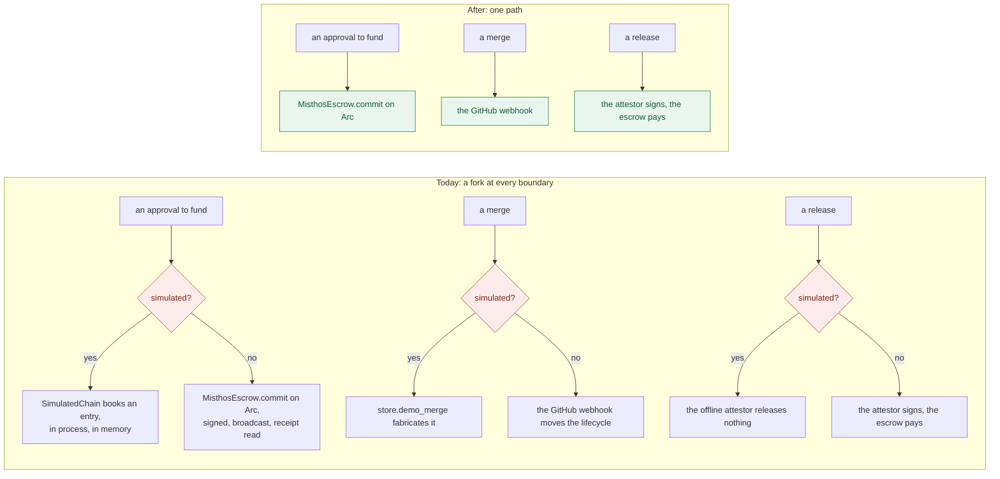
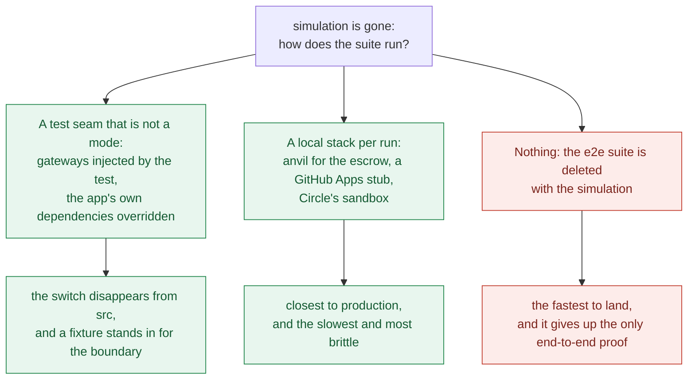
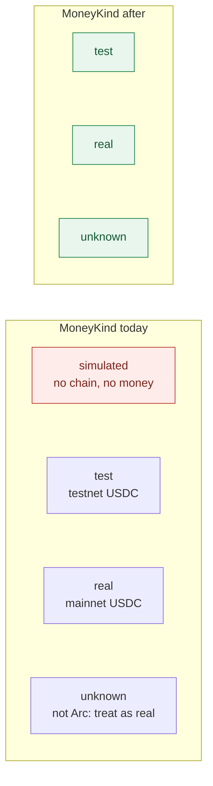

# Bounty: remove the simulation — the app runs live, and only live

Suggested labels: `enhancement`, `p0`, `area:backend`, `area:frontend`

## Deliverable

One pull request, merged, that deletes the simulation as a mode. `MISTHOS_SIMULATED` goes,
the simulated escrow goes, the demo endpoints and the stepper go, the seed goes, the demo
wallets go, the edge's simulated wallet service goes, and the test harness stops depending
on a runtime switch that exists to fake the money. Every path in the app then has exactly
one implementation, and it is the live one.

## Context

Simulation is not a corner of this codebase. It is the default, and a second implementation
of the money path, the identity path and the chain path hangs off it:

```mermaid
flowchart TD
    S["Settings.simulated<br/>defaults to True (config.py:17)"]
    S --> C1["build_chain returns SimulatedChain<br/>(services/chain/factory.py:29-31)"]
    S --> C2["the store's own books<br/>(services/chain/simulated.py)"]
    S --> G1["the guards let an anonymous caller write<br/>(api/session.py:41, :66)"]
    S --> G2["37 more reads across backend/src"]
    S --> D1["the demo stepper<br/>/advance, /complete, _demo_only"]
    S --> D2["/demo/issues/{id}/pull-request, /merge, /reset"]
    S --> D3["/auth/github/simulate, /demo/…/subscription/pay"]
    S --> SEED["the seed: made-up publishers,<br/>contributors and funded issues"]
    S --> W1["the frontend's demo wallets,<br/>keys in localStorage"]
    S --> W2["'the simulated GitHub' copy and buttons"]
    S --> E1["the edge's simulated wallet service"]
    S --> H1["playwright and CI run the API simulated"]

    classDef sw fill:#fdecea,stroke:#c0392b,color:#7b241c
    classDef dep fill:#fef9e7,stroke:#b7950b,color:#7d6608
    class S sw
    class C1,C2,G1,G2,D1,D2,D3,SEED,W1,W2,E1,H1 dep
```

How far it reaches, by area:

| Area | Files mentioning the switch | What is in them |
| --- | --- | --- |
| `backend/src` | 32 | the chain gateway and its factory, `store.reset`, `_seed`, `demo_pull_request`, `demo_merge`, `count_issues`, the guards, the health payload, the pricing/billing shortcuts |
| `backend/tests` | 18 | every suite that runs the API without a chain |
| `frontend/src` | 13 | `demoWallet`, the demo sign-in buttons, `github-link`'s `'simulation'` branch, the Circle short-circuit, `IssueActions`' simulated-GitHub controls, the money chip, the reset button |
| `frontend/e2e` | 6 | the harness in `playwright.config.ts:40` and the specs that sign in with a demo wallet |
| `edge/src` | 9 | `simulated.ts`, the wallet routes, the x402 gate, and the tests that assert simulation is the default |
| `.github/workflows/ci.yml` | 1 | `MISTHOS_SIMULATED: "true"` for every job |

The switch is also load-bearing in a way that is easy to miss: it is the reason the API can
start without a deployment. `build_chain` refuses to run live without one, on purpose —
"A live run without a deployment refuses to start, rather than discover at the first
approval that there is nowhere to put the money"
(`backend/src/misthos/services/chain/factory.py:1-7`) — and `assert_secrets_are_configured`
takes `settings.simulated` as its first argument (`backend/src/misthos/main.py:90`).

### The two paths, and the one that is left

### The one genuinely hard part: the test harness

Every end-to-end spec signs in with a demo wallet, and `playwright.config.ts` starts the API
with `MISTHOS_SIMULATED: 'true'` (`:40`). Delete the switch with nothing in its place and
six specs and CI's web job cannot run at all, because a live API wants a deployment, keys,
a GitHub App and Circle credentials. This is the decision the pull request has to make
deliberately rather than discover:

A seam is not the same thing as the switch. The switch is a **runtime flag in shipped code**
that anyone can set; a seam is a test-only stand-in at the boundary, with no branch in the
application. The point of this issue is that the second kind is the only kind left.

### What the money kinds become

`MoneyKind` (`backend/src/misthos/domain/network.py:21`) is
`Literal["simulated", "test", "real", "unknown"]`, and three surfaces read it: the health
payload's `money` and `money_note`, the network description's four sentences, the header
chip's mapping (`frontend/src/App.tsx:22-27`) and the landing page's
(`frontend/src/routes/Landing.tsx:55-60`). With the simulation gone, `"simulated"` is
deleted from the union, the chip mapping loses its first row, and every remaining branch is
a statement about a real network:

Removing the simulated kind is not the same as calling testnet mainnet: this deployment is
on Arc testnet, and what it says about the money still has to be true (#31). The chip
should read `USDC` and the note should still name testnet for what it is.

## The model

One setting fewer, one code path per boundary, and no mode in which the app pretends to
move money. What an operator configures becomes the truth, or the process does not start.

- **The chain is the escrow, always.** `build_chain` loses its branch, `SimulatedChain`
  and its module are deleted, and a missing or broken deployment is a startup failure with
  the reason named — which is what the factory already does once it is not simulated.
- **The demo surfaces are gone.** `/advance`, `/complete`, `/demo/issues/{id}/pull-request`,
  `/demo/issues/{id}/merge`, `/demo/reset`, `/demo/publishers/{id}/subscription/pay` and
  `/auth/github/simulate` are deleted, with `_demo_only`, `allow_demo_reset`, `store.reset`,
  `store.demo_pull_request` and `store.demo_merge`.
- **The seed is gone.** A fresh deployment starts empty: no made-up publishers, no
  contributors, no funded issues, and `seeded_issues` leaves the health payload.
- **Nothing anonymous writes.** `refuse_anonymous` and `require_owner_or_simulation` lose
  their simulation branches and become the plain rules they were always meant to be
  (`backend/src/misthos/api/session.py:39-43`, `:60-68`).
- **The wallet the user holds is the only wallet.** `demoWallet` and the two demo buttons
  go; MetaMask and Circle are the ways in, and a Circle-backed sign-in is the separate
  issue that makes the extension-free path real.

## What is yours to decide

Four calls belong to the publisher, and the pull request should mark them plainly.

- **How the suite runs (drawn above).** A test seam at the boundary, a local anvil plus a
  GitHub App stub, or no e2e suite. The first keeps the switch out of shipped code and is
  the recommended shape; the second is closest to production and the most expensive to keep
  green; the third gives up the end-to-end proof the project has been leaning on.
- **The other simulators.** The compliance providers have their own `"simulated"` names —
  identity auto-approves a session (`services/compliance/identity.py:31`), screening lists
  whatever `MISTHOS_SCREENING_DENYLIST` names
  (`services/compliance/screening.py:24`, `config.py:99-100`), and the attestor has an
  offline default that releases nothing (`services/attestor.py:54`). They are not behind
  `MISTHOS_SIMULATED`, so they survive this change by default — and a provider that
  approves everything is a worse thing to leave in production than a fake chain. Either
  they go too, or the pull request says exactly why they stay and what refuses them live.
- **`MISTHOS_SIMULATED`'s removal as a compatibility break.** Any deployment that still
  sets it should not keep running the live path silently because a variable was ignored.
  Refusing to start on an unknown-but-set variable, or naming it in the log once, is the
  publisher's call.
- **What happens to the existing demo data on the deployment.** The live database may hold
  rows the seed created. Deleting the seed code does not delete them, and whether the
  migration removes them or leaves them is a call.

## In scope

- **The switch itself:** `Settings.simulated` (`config.py:17`) and its 43 reads in
  `backend/src`, `MISTHOS_SIMULATED` in `backend/.env.example`, `compose.yaml`,
  `frontend/playwright.config.ts:40`, `.github/workflows/ci.yml` and the `mise.toml` tasks
  that pass it.
- **The chain:** `services/chain/simulated.py` and `build_chain`'s branch
  (`services/chain/factory.py:29-31`), the store's own books, and the startup checks that
  skip work while simulated (`main.py:70`, `:90`).
- **The demo endpoints and their store methods**, listed above, with `_demo_only` and
  `MISTHOS_ALLOW_DEMO_RESET`.
- **The seed:** `store._seed`, `_seed_publishers`, `_seed_contributors`, the seed lock, the
  `reset` step, and `seeded_issues` in `HealthOut`.
- **The guards:** the simulation branches in `refuse_anonymous` and
  `require_owner_or_simulation`, and every call site that leans on them.
- **The health and money kinds:** `simulated` and `seeded_issues` out of `HealthOut`,
  `"simulated"` out of `MoneyKind`, the four-sentence description down to three, and the
  chip and footer mappings in `frontend/src/App.tsx:22-27`, `:75`, `:107` and
  `frontend/src/routes/Landing.tsx:55-60`.
- **The frontend's simulation surfaces:** `demoWallet` and the demo sign-in buttons
  (`frontend/src/lib/wallet.ts:62-87`, `routes/Account.tsx:52-90`), the deployment banner
  and the Reset simulation button (`routes/Dashboard.tsx:22-30`, `:52-60`),
  `github-link.ts`'s `'simulation'` branch and its tests,
  `circle-wallet.ts`'s simulated short-circuit, and `IssueActions.tsx`'s simulated-GitHub
  controls (`:255`, `:441-460`, `:529-545`).
- **The edge:** `edge/src/simulated.ts`, the wallet routes' and x402 gate's simulated
  branches, and the tests that assert simulation is the default
  (`edge/src/circle-wallets.test.ts:53`, `:130`).
- **The harness**, however the call above settles it.
- **The tests** that exist only for the simulation: they are deleted with it, and the ones
  that merely ran under it are converted to the seam or the local stack.
- **The docs:** `AGENTS.md`'s "Current status" ("A scaffold with a working simulation … by
  default the money is fake — no chain is contacted", and the note that a live integration
  is not assumed because a module names one), `README.md`'s "### Signing in" and its
  wallet-extension paragraph, `docs/DEPLOY.md` §3, `docs/ARCHITECTURE.md` where it describes
  the two paths, and `CHANGELOG.md`.
- **The OpenAPI schema** and the regenerated `frontend/src/lib/api-schema.d.ts`.

## Out of scope

- **Making the live integrations work better.** Arc, the GitHub App and Circle are the only
  paths after this; whether they are configured on a given deployment is that deployment's
  problem, and this issue does not improve them.
- **Calling testnet mainnet.** Arc testnet stays labelled as testnet USDC (#31). This issue
  removes the mode in which no chain is contacted, not the honesty about which chain is.
- **The sign-in gate, the three-page removal, and the user's dashboard.** Those are separate
  issues. This one removes the mode those three have to reckon with — the gate's demo
  wallets, the removal's demo subscription payment, the dashboard's reset button — and each
  of them loses that branch when this lands.
- **The compliance providers and the attestor's offline default**, unless the call above
  takes them.
- **`contracts/`.** No contract change, and the deployed ABI at
  `contracts/deployments/5042002.json` must still match.

## Acceptance criteria

1. `MISTHOS_SIMULATED` is gone: from `Settings`, from `.env.example`, from `compose.yaml`,
   from `playwright.config.ts`, from CI, and from `mise.toml`. `rg -n "MISTHOS_SIMULATED" .`
   finds nothing outside the CHANGELOG's record of the removal.
2. `rg -n "simulated" backend/src frontend/src edge/src` finds no mode, no branch and no
   copy about a simulated run. What remains is only what the publisher's call above keeps,
   and each survivor is named in the pull request.
3. `SimulatedChain` and its module do not exist. `build_chain` has one path, and a live run
   with no deployment refuses to start with the reason named, as it does today.
4. The seven demo endpoints are gone from the API and from the OpenAPI schema, and
   `frontend/src/lib/api-schema.d.ts` is regenerated and compiles.
5. `store.reset`, `_seed`, `_seed_publishers`, `_seed_contributors`, the seed lock,
   `demo_pull_request` and `demo_merge` are gone, and a fresh deployment starts with no
   issues, publishers or contributors.
6. `HealthOut` carries no `simulated` and no `seeded_issues`, and `MoneyKind` has no
   `"simulated"`. The chip and the landing page still say which network and which money,
   and a testnet deployment still says testnet.
7. An anonymous caller cannot write anything, on any deployment, and neither can a caller
   acting for a party it does not own. The guards have no branch left, and the tests that
   prove it are the plain ones rather than a simulated special case.
8. The frontend has no demo wallet, no demo sign-in button, no Reset simulation button and
   no simulated-GitHub control. Signing in requires MetaMask or Circle, and every issue
   action names a real GitHub action rather than a fabricated one.
9. The edge has no simulated wallet service, and a live configuration without Circle
   credentials refuses to start with the missing variable named — the behaviour
   `edge/src/circle-wallets.test.ts` already pins for `MISTHOS_SIMULATED: 'false'`.
10. The suite runs without the switch, by whichever of the three shapes the call above
    chose, and the choice is stated in the pull request. If the e2e suite is kept, the specs
    sign in the way a user does; if it is dropped, the pull request says what end-to-end
    proof replaces it and the CHANGELOG says so plainly.
11. A deployment that still sets `MISTHOS_SIMULATED` does not silently run live: it is
    either refused at startup or it names the variable once, as the call above decided.
12. `contracts/`, `MisthosEscrow.sol`, its tests and `contracts/deployments/5042002.json`
    are untouched.
13. The docs match the code: no README, architecture, deployment or agent document says the
    money is fake by default, offers a demo path, or describes two chains. `CHANGELOG.md`
    records what went.
14. The suites pass after the deletion, and the pull request states the before and after for
    all four, so the fall in the count is accounted for and not an accident: at the head of
    `main` they are 1128 of 1172 collected, 64, 125 and 16.
15. The tests are the record of the change: one that a live run with no deployment refuses
    to start, one that an anonymous write is refused on a live configuration, one that no
    endpoint uses one of the removed demo routes (a 404 rather than a hidden branch), one
    that the health payload carries no simulated field, and one that the money chip names
    the network correctly for testnet and for mainnet.

## How this settles

The review agent reads the pull request against the acceptance criteria and the
repository's test suite and issues a verdict; the publisher makes the final call and
merges, and USDC releases on merge or when the silent-publisher grace period expires.
There is one way the app moves money and one way it settles, the way a user signs in is the
way they will be paid, the demo surfaces are gone from shipped code, and the test suite
stands on a seam or a local stack rather than on a runtime flag that exists to fake the
money.
