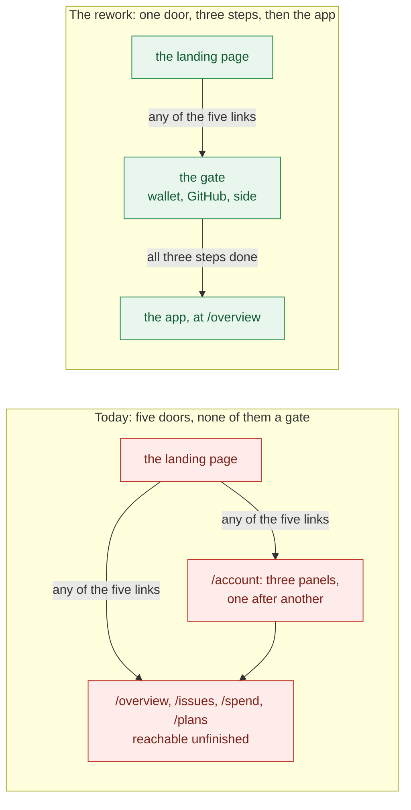
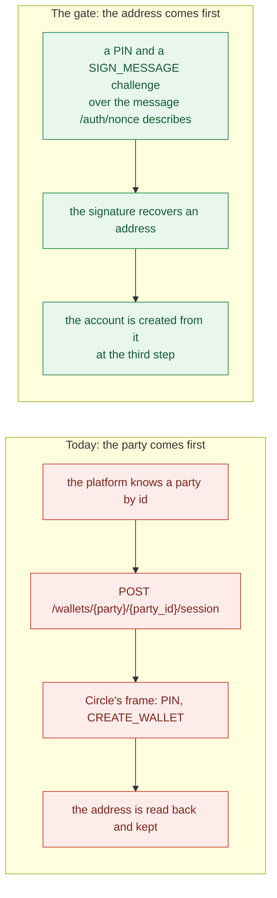
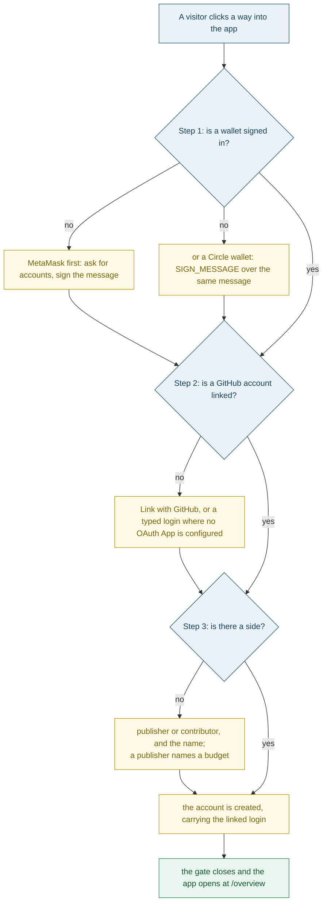
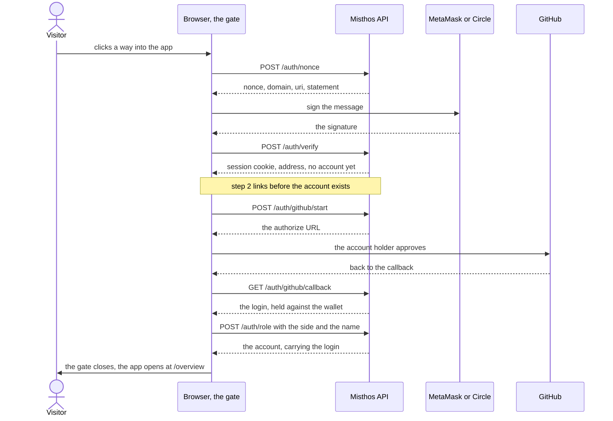
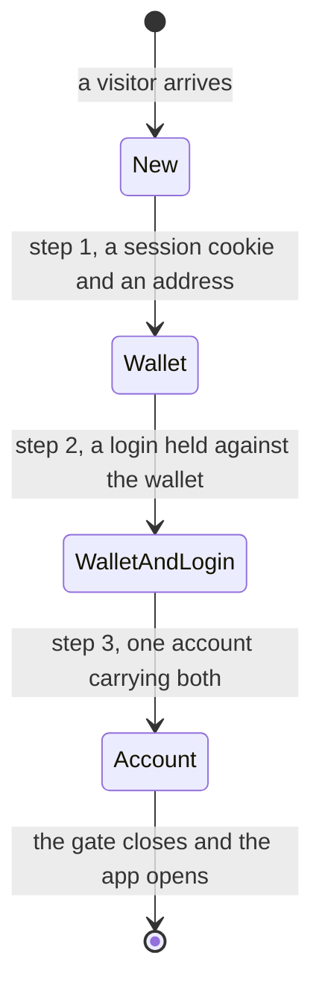
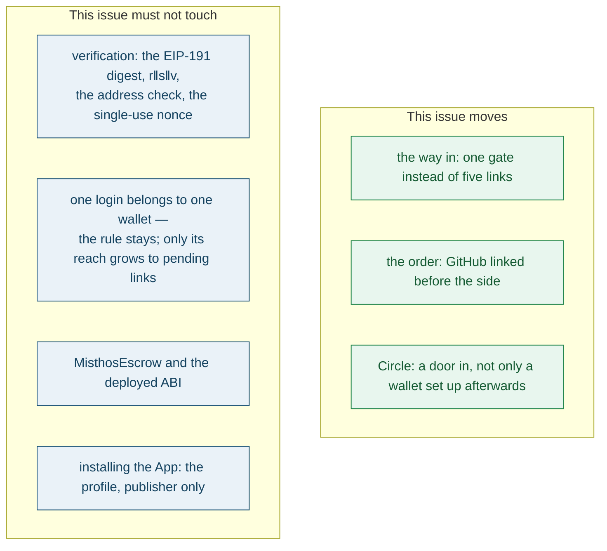

# Bounty: rework the way in — one gate: a wallet, a GitHub account, then a side

Suggested labels: `enhancement`, `p1`, `area:backend`, `area:frontend`

## Deliverable

One pull request, merged, that replaces the way a visitor gets into Misthos with a single
mandatory gate: prove a wallet (MetaMask first, a Circle wallet as the second way in), link
a GitHub account, then choose publisher or contributor and name the party. The gate closes
and the app opens only when all three steps are done.

This is a rework, not an addition. The screens that carry the old shape are expected to be
replaced rather than extended, and nothing in this issue is a patch on top of them.

## Context

*Sign in* is a link today. `HeaderAction` renders it as a `Link` to `/account`
(`frontend/src/routes/Landing.tsx:152-161`), and the class it carries,
`demo-preview-trigger`, is a memento of the `landing-page-for-misthos` prototype whose
wallet sign-in was never ported (`frontend/src/landing.css:479-480`; CHANGELOG, #140 and
#167). The prototype's way in was a button that opened its own surface. This issue is that
surface, finished, with the real API behind it.

Five links lead from the landing page into the app, and not one of them asks who is
arriving: *Sign in* and *Open the app* (`Landing.tsx:155`, `:159`), *Plans*
(`Landing.tsx:232`), an issue row (`frontend/src/components/LandingIssues.tsx:108`) and
*See every issue* (`LandingIssues.tsx:170`). Inside, the app's nav offers *Sign in* too
(`frontend/src/App.tsx:89-90`), and `App.tsx:130-150` guards no route at all.

What is wrong with the old shape is not that a stranger can look around. It is that the app
finds out who they are one refusal at a time: `require_role` answers "sign in to …" and
`require_github` answers "link your GitHub account to …"
(`backend/src/misthos/api/session.py:45`, `:53`), after the visitor has already been shown
a wallet address, a nav, and the word *Sign in* on a page they can reach. A refusal is not
an instruction, and the first two minutes decide whether the third step ever happens.

The three steps exist, in the order the API happens to ask for them — the Account page
says so in its own words: "prove a wallet, take a side once, link a GitHub account"
(`frontend/src/routes/Account.tsx:11-14`). The gate's order is the reverse, and the
reversal is the part that is genuinely new work.

### Linking GitHub before a side is a real change

The gate links GitHub before the side is chosen, and the API enforces the opposite today:
`POST /auth/github/start` is refused with "sign in and choose a role first" while the
wallet has no account (`backend/src/misthos/api/v1/auth.py:181-186`), because the account
is created by `POST /auth/role` (`auth.py:142`, `store.create_account`, `store.py:2751`)
and `store.link_github` needs that account to exist already (`store.py:2803-2805`). So the
login has to be held somewhere until the third step creates the account, and handed over
when it does. One login still belongs to one wallet (`repositories/base.py:41`, enforced at
`repositories/memory.py:235` and `repositories/sql.py:297`), and that rule has to cover a
link that is still pending as much as one that is complete.

```mermaid
flowchart TD
    subgraph TODAY["Today: the party exists before the login does"]
        T1["step 1: a wallet signs in"] --> T2["step 2: POST /auth/role creates the account"]
        T2 --> T3["step 3: POST /auth/github/start<br/>refused unless the account exists"]
        T3 --> T4["store.link_github writes the login onto the account"]
    end
    subgraph GATE["The gate: the login arrives before the account does"]
        G1["step 1: a wallet signs in"] --> G2["step 2: the login is held against the wallet,<br/>pending, and takes the one-login-one-wallet slot"]
        G2 --> G3["step 3: POST /auth/role creates the account<br/>and adopts the held login"]
        G3 --> G4["the account has both, and neither can be moved"]
    end

    classDef old fill:#fdecea,stroke:#c0392b,color:#7b241c
    classDef new fill:#fef9e7,stroke:#b7950b,color:#7d6608
    class T1,T2,T3,T4 old
    class G1,G2,G3,G4 new
```

### The Circle door is the second way in

The first step is two doors to one session. MetaMask already works: `browserWallet` asks
for accounts and signs with `personal_sign` (`frontend/src/lib/wallet.ts:44-58`). A
Circle wallet is a signer the server has never seen the front of: Circle is set up *after*
sign-in today, for a party the platform already knows by id
(`frontend/src/lib/circle-wallet.ts:66-75`, the `wallets.py` routes behind it, and
`edge/src/circle-wallets.ts` states the assumption out loud). Sign-in needs the exact
reverse — an address first, the party built from it — which is what
[#137](https://github.com/vanduc2514/hackathon-circle-misthos/issues/137) maps out and what
this issue implements. The SDK does support `ChallengeType.SIGN_MESSAGE` (#137 quotes the
installed typings), so verification itself does not change: the message is the one
`POST /api/v1/auth/nonce` describes (`auth.py:74`, `frontend/src/lib/siwe.ts`), the
signature is the answer to a `SIGN_MESSAGE` challenge, and `POST /api/v1/auth/verify`
recovers the address exactly as it does for MetaMask (`auth.py:88`,
`backend/src/misthos/auth/siwe.py`).

## The model

A visitor arrives with nothing. Three things are asked of them, in this order, each one
keeping what is already true and refusing what contradicts it.

Read end to end, with the other parties in it:

What the visitor's record holds after each step. This is what makes the order defensible:
abandoning the gate at any point undoes nothing, and no account exists until the last step.

Three properties make it a gate rather than a wizard:

- **Mandatory.** Every landing link that would take an unfinished visitor into the app
  opens the gate instead, and the header says *Finish signing in* while the gate is
  unfinished rather than *Open the app*.
- **Resumable.** Leaving early — Esc, the close control, the backdrop — costs nothing and
  loses nothing. Reopening starts at the first unfinished step and never re-asks a step
  that is done.
- **Honest.** Each step says what it is for and what is missing. The second step names the
  GitHub account because a publisher's issues and a contributor's pull requests are matched
  by login (`session.py:53`), and the first step says that the wallet signed in with is the
  wallet the money moves through.

The rework is bounded on both sides. What it moves, and what it must not touch:

Installing the App is **not** a fourth step, and the decision behind that stands:
installing authorizes nothing about the person, which is why
`frontend/e2e/install-app.e2e.ts:5-12` says so. Only a publisher is offered it, on their
own profile (`backend/src/misthos/api/v1/publishers.py:162`).

## What is yours to decide

Four calls belong to the publisher, and the pull request should mark them plainly.

- **What the profile becomes.** The gate takes over signing in, so `/account` stops being a
  second, older onboarding. What it keeps is identity and money — who you are, the wallet
  the money moves through, the repositories the App is on — and what it keeps has to not
  re-run the three steps. The exact shape is the publisher's call.
- **What happens to Circle after sign-in.** Once a Circle wallet can be the way you sign
  in, a separate "set up or reconnect your Circle wallet" panel describes a second wallet
  for the same money. #137 argues it goes, because the wallet you sign in with is the wallet
  the money goes to. Keeping a way to switch the wallet the money moves through is also
  defensible while MetaMask sign-in is the common case.
- **Which face of the Circle door to take.** #137 leaves three: the Circle wallet signs the
  sign-in message (its variant A, which this issue assumes); Circle's own email or social
  login is the door and the wallet is only the signing device (B); or Circle's
  authentication is trusted and no message is signed at all (C). C is a weaker guarantee
  than the platform has today and should be a conscious choice rather than a shortcut taken
  because a challenge was awkward.
- **A publisher's budget field** (`RoleRequest.budget_usdc`,
  `backend/src/misthos/schemas.py:439-445`). It is required today, with `5000` behind it.
  In a mandatory gate it is one more field between a visitor and the app, so making it
  optional for a publisher is a product call rather than an engineering one.

## In scope

- **The gate itself:** one surface, opened from the landing page, in the landing's own look
  — the card's border, radius and shadow and the Georgia headings, as `landing.css:141-160`
  draws them. Its internal structure is the pull request's call.
- **Replacing the old way in.** The five landing links go through the gate
  (`Landing.tsx:155`, `:159`, `:232`, `LandingIssues.tsx:108`, `:170`), the app's nav
  *Sign in* (`App.tsx:89-90`) leads to the same place, and no second, older onboarding is
  left anywhere in the app.
- **The wallet step:** MetaMask (`wallet.ts:44-58`) and Circle as a second door, with the
  simulation's demo wallets unchanged beside them (`wallet.ts:62-87`).
- **The GitHub step before the side:** `POST /auth/github/start` accepts a signed-in wallet
  with no account (`auth.py:181`); the login is held against that wallet; `POST /auth/role`
  (`auth.py:142`, `store.create_account`, `store.py:2751`) adopts it onto the new account;
  `POST /auth/github/simulate` (`auth.py:246`) does the same in the simulation; and the
  one-login-one-wallet rule covers pending links (`repositories/base.py:41`,
  `memory.py:235`, `sql.py:297`). The OAuth state and the session binding
  `github_callback` depends on (`auth.py:207-244`) are unchanged.
- **The Circle identity path:** routes that are not keyed by a party, a `SIGN_MESSAGE`
  challenge over the message `POST /auth/nonce` describes, and no change to how the server
  recovers the address (`auth/siwe.py`).
- **The OpenAPI schema** for every changed endpoint and response, and the regenerated
  `frontend/src/lib/api-schema.d.ts`.
- **`CHANGELOG.md`,** under Unreleased, in the voice the entries there already use.
- **The tests:** the suites may be reorganised, and the specs that walk the old flow
  (`frontend/e2e/loop.e2e.ts:31`, `rework.e2e.ts:10`, `criteria-navigation.e2e.ts:24`)
  are rewritten to the new one rather than left half-true.

## Out of scope

- Installing the GitHub App as a step of the gate, or for a contributor at all. The
  decision and the test that records it stand (`frontend/e2e/install-app.e2e.ts:5-12`).
- A guard on every app page. This is the way in: `/issues`, `/spend` and the rest keep
  their addresses and their behaviour, and a visitor who types one is not this issue's
  business.
- Changing verification. The EIP-191 digest, the 65-byte `r‖s‖v`, the address-in-message
  check and the single-use nonce stay exactly as they are
  (`backend/src/misthos/auth/siwe.py`, `auth.py:88-124`).
- A profile beyond identity: no new username, no avatar, no display name beyond the `name`
  the third step already collects (`schemas.py:439-445`).
- `contracts/`. No contract change, and the deployed ABI at
  `contracts/deployments/5042002.json` must still match.
- Analytics on the gate, and any funnel instrumentation.

## Acceptance criteria

1. On the landing page, *Sign in* opens the gate rather than navigating, and every other
   landing link into the app (`Landing.tsx:155`, `:232`, `LandingIssues.tsx:108`, `:170`)
   opens the gate instead of the page while the gate is unfinished.
2. Step 1 offers MetaMask first and a Circle wallet as a second way in, and either one
   completes step 1. With no wallet extension present the gate says so rather than leaving
   a dead button.
3. MetaMask sign-in is the flow that exists: `/auth/nonce`, the message `siweMessage`
   builds, `personal_sign`, `/auth/verify`, the session cookie. Outside the simulation
   nothing is written anonymously (`session.py:39-43`).
4. A Circle wallet completes the same step by signing the same message through
   `ChallengeType.SIGN_MESSAGE`, and `/auth/verify` recovers the same address from its
   signature as from MetaMask's. No path around `siwe.verify` is opened, and a signature
   that does not recover the address the message names is refused exactly as today.
5. Step 2 links a GitHub account before a side exists: a signed-in wallet with no account
   can start and finish a link, and the refusal at `auth.py:186` is gone.
6. A login already bound to another wallet is refused with the conflict named, including
   when the other wallet's link is pending rather than complete. One login still belongs to
   one wallet.
7. Step 3 collects the side and the name — and a budget for a publisher — and creates
   exactly one account, carrying the linked login. A second attempt on the same wallet is
   refused with the conflict named (`AccountExists`, `store.py:2763-2764`).
8. Completing step 3 closes the gate and shows the app's overview. A click from the landing
   page does not reach the app with the gate unfinished, and the header reads *Finish
   signing in* rather than *Open the app* while it is unfinished.
9. Leaving the gate early costs nothing and loses nothing: closing it leaves no account
   behind and does not open the app, and reopening starts at the first unfinished step and
   never re-asks a step that is done.
10. The gate is a real dialog: `role="dialog"` with `aria-modal` and a labelled heading,
    focus moves into it when it opens and back to the control that opened it when it
    closes, Esc closes it, and every control is reachable and named for a screen reader.
11. There is one implementation of the three steps. Whatever the profile page shows, it is
    not a second, older signing-in, and the two cannot disagree about what is missing.
12. The simulation keeps working end to end: the demo publisher and contributor wallets
    sign in (`wallet.ts:62-87`), a typed login links GitHub when no OAuth App is configured
    (`frontend/src/lib/github-link.ts:3-9`), and no Circle frame is opened.
13. On a phone the gate fits the viewport and never scrolls the page sideways, the rule
    `frontend/e2e/app-look.e2e.ts:43` applies to every app page.
14. A publisher is still offered installing the GitHub App, on their profile and only after
    a login is linked — the behaviour `frontend/e2e/install-app.e2e.ts` asserts.
15. The OpenAPI schema describes every changed endpoint and its responses, and the
    regenerated `frontend/src/lib/api-schema.d.ts` compiles with the web app.
16. `MisthosEscrow.sol`, its tests and `contracts/deployments/5042002.json` are untouched.
17. Backend, contract, frontend and end-to-end suites pass, and the count of passing tests
    does not fall below the current 1128 (of 1172 collected), 64, 125 and 16.
18. The tests are the record of the gate: one that a landing link opens the gate instead of
    the page, one that each of the two wallet doors produces a session and the same
    address, one that linking works before a side exists, one that a login claimed by
    another wallet — pending or complete — is refused, one that the third step creates the
    account once and carries the login, one that reopening resumes at the first unfinished
    step, one that the app is not reachable from the landing page unfinished, and one that
    the gate is a dialog a keyboard can leave.

## How this settles

The review agent reads the pull request against the acceptance criteria and the
repository's test suite and issues a verdict; the publisher makes the final call and
merges, and USDC releases on merge or when the silent-publisher grace period expires.
A visitor arrives at the landing page, and one gate — a wallet, a GitHub account, a side —
is what stands between them and the app. MetaMask and a Circle wallet are two doors to the
same session, the GitHub login is linked before the side is chosen and carried onto the
account when it is created, and the gate is the only way in.
