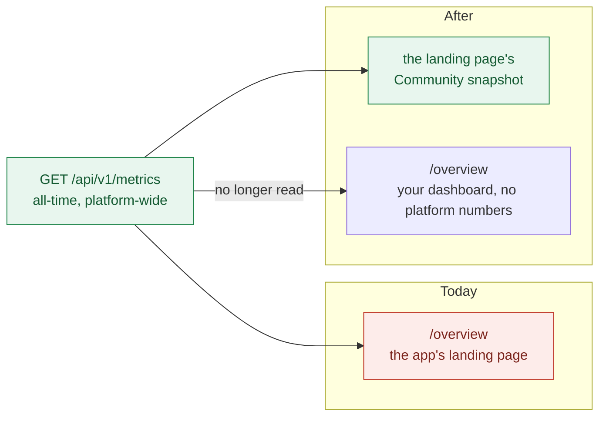
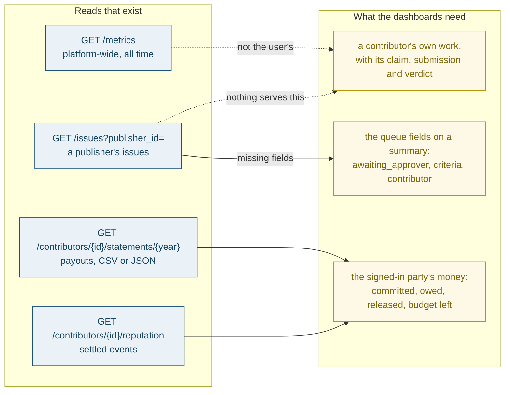
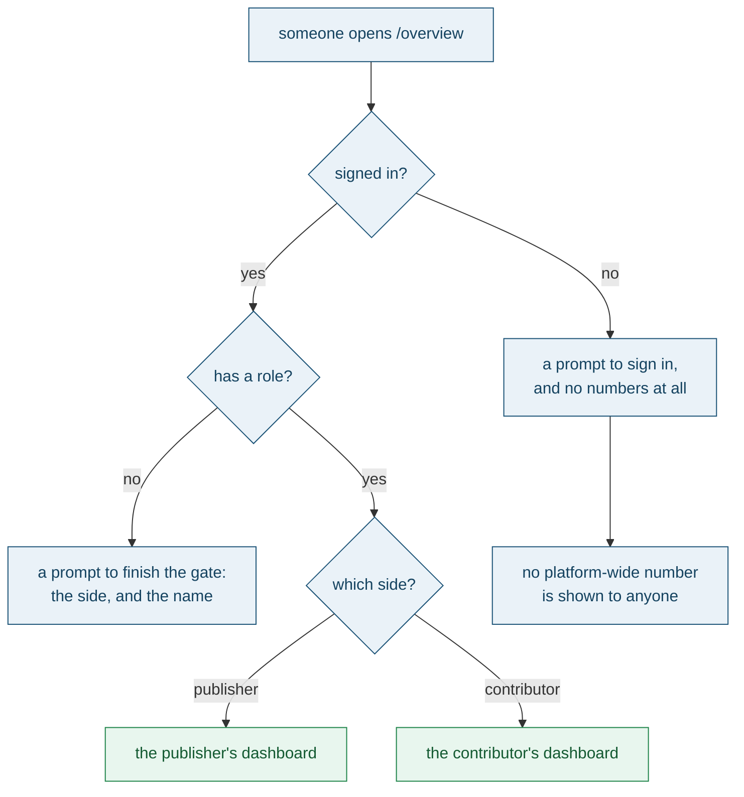
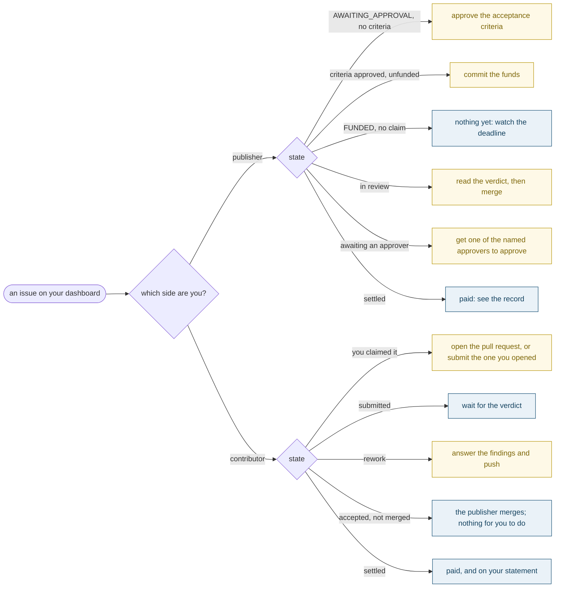

# Bounty: Overview becomes the signed-in user's dashboard — a publisher's, and a contributor's

Suggested labels: `enhancement`, `p1`, `area:backend`, `area:frontend`

## Deliverable

One pull request, merged, that replaces `/overview` with a dashboard for whoever is signed
in: a publisher sees the issues they funded and what waits on them, a contributor sees the
work they claimed and what they are owed. The all-time platform funnel, the marketing
chrome and the hard-coded signal bars come off the page, and the platform-wide numbers go
back to the only place they belong — the landing page's community snapshot. Nothing else
changes.

## Context

`/overview` is the one app page that never mentions who is looking at it. It renders
`MetricsOut` (`frontend/src/routes/Dashboard.tsx:10-13`, `backend/src/misthos/schemas.py:311-345`),
a platform-wide, all-time funnel, with no `useMe` anywhere in the file.

What is on the page today, and what it is:

| Block | Where | What it is |
| --- | --- | --- |
| "The treasury, running itself", and a paragraph explaining the product | `Dashboard.tsx:44-51` | The landing page's job, in the app |
| An obols-of-Athens pull quote | `Dashboard.tsx:83-92` | Marketing copy in a dashboard |
| North star, settled this week | `Dashboard.tsx:76-82` | Platform-wide, all time |
| Matched volume, funded, settled, overturns | `Dashboard.tsx:101-124` | Platform-wide, all time |
| Claim rate, acceptance, repeat publishers | `Dashboard.tsx:126-145` | Platform-wide, all time |
| Refund rate, dispute rate, $500 share, top-10 share | `Dashboard.tsx:147-170` | Platform-wide, all time, with target thresholds |
| "Signals that decide the price": six bars at fixed 25/20/15/15/15/10 | `Dashboard.tsx:186-198` | Hard-coded illustration, presented as data |
| Where the issues are, by state | `Dashboard.tsx:173-183` | Platform-wide |
| Recent decisions, across every issue | `Dashboard.tsx:200-224` | Platform-wide |
| Issues needing a human | `Dashboard.tsx:226-244` | The only block that is nearly a dashboard, and it is everyone's |

Nine of those ten blocks answer a question a user does not have. A contributor cannot act
on the refund rate; a publisher cannot act on the top-10 payout share; the signals panel
is a picture of the weights rather than a reading of any issue; and the pull quote is
there to persuade a visitor who has already signed in.

### Where the platform numbers can live instead

The landing page already reads the same endpoint for its community snapshot
(`frontend/src/routes/Landing.tsx:169-170`, `:176-204`), so the honest home for
platform-wide numbers exists and is public. This is a move, not a deletion:

`/api/v1/metrics`, `MetricsOut` and every number in it stay. What changes is that no page
of the app reads them, which is also what makes the page honest: the app stops showing a
signed-in user a marketplace funnel they cannot touch.

### The data the two dashboards need does not exist yet

This is the part that is real work rather than a re-layout. The reads that exist are
platform-wide or one issue at a time:

- **A publisher's own issues:** `GET /issues?publisher_id=` (`backend/src/misthos/api/v1/issues.py:141-156`)
  exists. But `IssueSummaryOut` (`schemas.py:296-308`) carries no `awaiting_approver`, no
  `criteria_approved_at` and no `contributor_id`, and those three are exactly what a
  publisher's queue is sorted by. They are on `IssueOut` only (`schemas.py:283`, `:289-293`).
- **A contributor's own work:** there is **no** contributor filter on `GET /issues`. A
  contributor's claimed issues, their submission state and their verdict are reachable only
  by reading issues one by one. `GET /contributors/{id}/reputation`
  (`backend/src/misthos/api/v1/contributors.py:29`) gives settled events, and
  `GET /contributors/{id}/statements/{year}` (`:48`) gives payouts for a year — both
  per-contributor, both after the fact, neither a work list.
- **What a party is owed, and what it has committed:** the publisher's `Publisher` record
  carries `budget_remaining_usdc`; a contributor's `ContributorProfile`
  (`schemas.py:102-110`) carries `earned_usdc`, `settled_issues` and `reputation`. Neither
  is served for the *signed-in* party in one read.

The page must be scoped by the **session**, not by a party id in the query string. A
dashboard whose subject is a query parameter is a page about anybody, and outside the
simulation it would be a page about somebody else; the account's own `party_id` is what
the request already carries (`backend/src/misthos/api/session.py:32-37`), and the
dashboard reads it.

## The model

Two dashboards behind one address, chosen by the account's role. A publisher's page is
about issues that need a decision from them; a contributor's page is about work in flight
and money owed. Both open with who is acting and both end with the next action, because
that is the whole point of a dashboard.

```mermaid
flowchart TB
    subgraph PUB["A publisher's dashboard"]
        P1["acting as: the organisation,<br/>the linked GitHub login"]
        P2["what waits on you<br/>criteria to approve, a price to name,<br/>a verdict to merge, an approver"]
        P3["your issues<br/>with their state and the next action"]
        P4["your money<br/>budget left, committed in escrow,<br/>released and paid out"]
        P5["your repositories<br/>what the App is connected to"]
        P1 --> P2 --> P3 --> P4 --> P5
    end
    subgraph CON["A contributor's dashboard"]
        C1["acting as: your handle,<br/>your reputation and settled count"]
        C2["what waits on you<br/>rework to answer, a merge,<br/>a payout wallet to connect"]
        C3["your work<br/>claimed, submitted, in review, decided"]
        C4["what you are owed<br/>committed, about to release, paid this year"]
        C1 --> C2 --> C3 --> C4
    end

    classDef pub fill:#eaf2f8,stroke:#1a5276,color:#154360
    classDef con fill:#e8f6ee,stroke:#1e8449,color:#145a32
    class P1,P2,P3,P4,P5 pub
    class C1,C2,C3,C4 con
```

What the page shows, by who is asking. A half-onboarded account is not shown a dashboard
about nothing: it is pointed at the step it has not finished.

The catalogue of state a row can be in is finite and already known, so the "next action" is
a function of the record rather than a judgement made in the browser:

Three properties make it a dashboard rather than another report:

- **It is about you, and no one else.** Every number on it is derived from the signed-in
  party's own issues, claims and settlements. Another party's work is not reachable from
  it, and neither is the platform's.
- **Every row has a next action.** A row that needs nothing from you says so, rather than
  being left for the user to work out from a state name.
- **Nothing is decorative.** No pull quotes, no weights drawn as bars, no all-time
  aggregate, and no target thresholds with no bearing on this user's week.

## What is yours to decide

Four calls belong to the publisher, and the pull request should mark them plainly.

- **Whether the page's name changes.** "Overview" is what the nav says
  (`frontend/src/App.tsx:48-50`). "Dashboard", or "Your work", would say what it is now;
  keeping "Overview" is one less thing in the diff.
- **Where the Reset simulation button goes** (`Dashboard.tsx:22-30`, `:52-60`, asserted at
  `frontend/e2e/dashboard-mode.e2e.ts:19`). It is a demo affordance on a page that is now
  personal, and the deployment banner is the other place it fits. The honesty banner
  itself must stay — a contributor's page still has to say that the money is simulated.
- **The first read's shape.** One session-scoped read that returns the whole dashboard, or
  the existing reads widened (a contributor filter on `/issues`, the queue fields on
  `IssueSummaryOut`, the signed-in party on `/contributors` and `/publishers`). One read is
  one round trip and one place to get the scoping right; widening keeps the API's shape
  flatter for other callers. The owner of the code should choose.
- **A contributor's money line.** "Owed" can mean what is committed and not yet released,
  or what has been released and not yet withdrawn, or both. The escrow is the only
  authority on the first, and the ledger on the second.

## In scope

- **The page, rebuilt around the session:** `frontend/src/routes/Dashboard.tsx`, using
  `useMe` (`frontend/src/lib/session.ts:14-25`) to choose the dashboard, and the existing
  `Panel`, `Stat`, `Bar` and `StateBadge` components (`frontend/src/components/ui.tsx:19-100`).
- **Off the page:** the platform-wide metrics block and its five rows; the Athens pull
  quote; the "treasury, running itself" title and its product paragraph; the "Signals that
  decide the price" panel with its hard-coded values (`Dashboard.tsx:186-198`); the
  platform-wide "where the issues are" bars; and the across-every-issue decision feed.
- **The reads the two dashboards need:** a session-scoped source of the signed-in party's
  issues with their next-action state, and of that party's money — new route or widened
  ones, whichever the call above chooses. `require_owner_or_simulation`
  (`backend/src/misthos/api/session.py:60-68`) and `refuse_anonymous` (`:39-43`) are the guards the new read
  sits behind, and outside the simulation an anonymous caller gets a 401.
- **The queue fields, wherever they end up:** `awaiting_approver` and
  `criteria_approved_at` (`schemas.py:289-293`) and a way to filter issues by
  `contributor_id`, if the read is widened rather than added.
- **The publisher's money without the spend feature.** The spend view and its endpoint are
  the subject of a separate issue; this page derives committed, released and budget-left
  from the publisher's own issues and its `Publisher` record, and links to no spend page.
- **The anonymous and half-onboarded states**, as drawn above.
- **The tests:** `frontend/e2e/dashboard-mode.e2e.ts` follows the page, and new specs cover
  the two dashboards, the two prompts, and that nothing platform-wide is on the page.
- **The OpenAPI schema** for whatever is added or widened, and the regenerated
  `frontend/src/lib/api-schema.d.ts`.
- **`CHANGELOG.md`,** under Unreleased.
- **`docs/ARCHITECTURE.md:175`** where it describes the overview, if it still does.

## Out of scope

- **`/api/v1/metrics` and `MetricsOut`.** Every number and its docstring stays; the landing
  page's community snapshot keeps reading it (`Landing.tsx:169-170`).
- **The landing page.** Its own look, its snapshot and its issue table are not this issue's.
- **The gate, and a guard on every app page.** A direct visit to `/overview` stays allowed;
  what an unfinished visitor sees there is the prompt above, which is the page's own empty
  state rather than a route guard. The sign-in gate is a separate issue.
- **The other pages.** `/issues`, the issue detail page, `/publish` and the nav are not
  reorganised here, beyond the links the dashboard needs.
- **The lifecycle, the pricing engine and the money path.** No state machine change, no
  price change, no contract change, and `contracts/deployments/5042002.json` is untouched.
- **Removing the Loop, Spend and Plans pages.** That is a separate issue, and this page
  must not link to any of them either way.

## Acceptance criteria

1. Opening `/overview` signed in as a publisher shows a publisher's dashboard, and signed
   in as a contributor shows a contributor's. The two do not share a layout that only
   differs by which numbers are filled in.
2. Every number on the page is derived from the signed-in party's own records. A publisher
   cannot see a contributor's work from it, and a contributor cannot see a publisher's —
   with a test that signs in as each and asserts the other's issue is absent.
3. The page is scoped by the session. No dashboard read takes a party id from the client,
   and outside the simulation an anonymous or unowned request is refused with the guard the
   rest of the API uses (`backend/src/misthos/api/session.py:39-43`, `:60-68`).
4. No block from the old page remains: no platform-wide matched volume, funded or settled
   count, claim rate, acceptance rate, repeat publishers, refund rate, dispute rate, $500
   share, top-10 share, no across-every-issue decision feed, no pull quote, and no
   hard-coded signal bars. `rg -n "metrics" frontend/src/routes/Dashboard.tsx` finds
   nothing.
5. Every row states its next action, and the action matches the state: a publisher's
   unfunded issue offers approving the criteria; an accepted, unmerged submission says the
   publisher merges and nothing is asked of the contributor; a rework says to answer the
   findings.
6. A contributor's dashboard is reachable and complete: their claimed work with its claim,
   submission and verdict, what is owed, what is settled, and the state of the wallet their
   payouts go to, with a link to set it up when it is missing.
7. A publisher's dashboard is complete without the spend view: their issues by what waits on
   them, their committed and released amounts, their remaining budget, and their connected
   repositories.
8. An anonymous visitor to `/overview` sees a prompt to sign in and **no** numbers, no
   issue titles and no counts belonging to any party.
9. A signed-in account with no role sees a prompt to finish choosing a side and naming the
   party, and no dashboard.
10. The deployment's honesty survives: the page still says which network and which money
    this deployment uses, and a simulation still says the money is fake. What the page says
    is not a claim about a specific party.
11. `/api/v1/metrics` still answers, unchanged, and the landing page's community snapshot
    still shows it — asserted, so the numbers were moved rather than deleted.
12. The page works on a phone with no sideways scroll, and its tables scroll inside their
    panels, the rule `frontend/e2e/app-look.e2e.ts:43` already applies to every app page.
13. The OpenAPI schema describes every new or changed read, and the regenerated
    `frontend/src/lib/api-schema.d.ts` compiles with the web app.
14. `contracts/`, `MisthosEscrow.sol`, its tests and `contracts/deployments/5042002.json`
    are untouched, and the backend, contract, frontend and end-to-end suites pass with the
    count of passing tests no lower than 1128 of 1172 collected, 64, 125 and 16.
15. The tests are the record of the change: one per role that its dashboard renders from
    its own records, one that each role cannot see the other's work, one that the anonymous
    page shows no numbers, one that a half-onboarded account is prompted rather than shown
    a dashboard, one that the next action matches a state on each side, and one that
    `/metrics` and the landing page's snapshot still work.

## How this settles

The review agent reads the pull request against the acceptance criteria and the
repository's test suite and issues a verdict; the publisher makes the final call and
merges, and USDC releases on merge or when the silent-publisher grace period expires.
The app's first page stops describing the marketplace to its own users and starts telling
each of them what is theirs and what waits on them, while the platform-wide numbers keep
the one home they were always better suited to: the public landing page.
